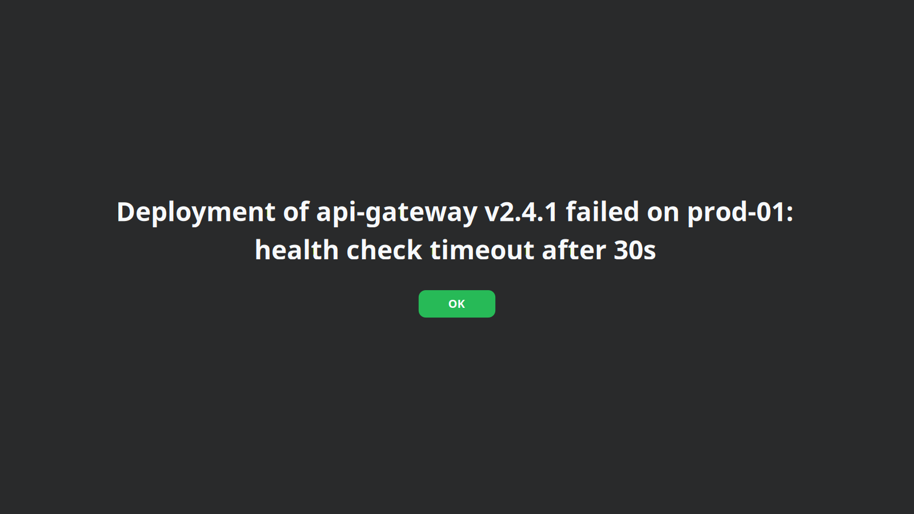
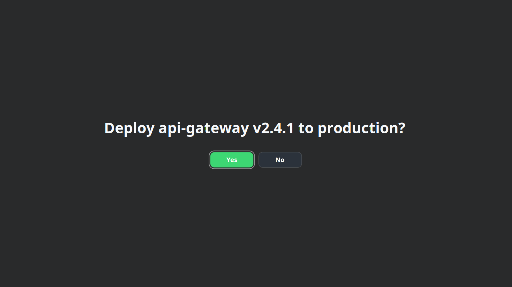

# notify-fullscreen

A tiny fullscreen notifier for Linux: it dims the screen, shows a message and
waits until you acknowledge it with a green **OK** button — or, with
`--confirm`, until you answer **Yes** or **No** (the exit status tells you
which).

It is meant for the things you *must* see — a finished long build, a failed
cron/backup job, a deploy that went wrong — without a notification daemon and
without growing into a framework.

```
$ notify-fullscreen "Deployment of api-gateway v2.4.1 failed on prod-01: health check timeout"
```



<sub>The overlay rendered with `--preview-png`: the background is 85% opaque,
so the desktop behind it stays visible.</sub>

* **40 KB** single binary, ~14 MB RSS (almost all of it shared system libs),
  ~10 ms until the overlay is on screen. No daemon, no config file, no runtime.
* **Translucent background** (85% opaque by default) so you still see what is
  behind the message.
* **Fullscreen and always on top**, above every window, with keyboard focus.
* Plain **X11 / Xwayland** — works on GNOME/KDE Wayland sessions (which ship
  Xwayland), on Hyprland, sway, i3, XFCE and friends.
* Message is **wrapped and auto-sized**: short messages get a big font, long
  ones shrink to fit.
* Optional **Yes/No question mode**: `yes` exits `0`, `no` exits `1`, so it
  drops straight into `if notify-fullscreen --confirm …; then`.
* Optional **focus restore**: `--refocus` gives the keyboard back to the window
  that was active before the notification appeared — and, when the command ran
  inside tmux, back to that pane and its window.

```sh
$ notify-fullscreen --confirm "Deploy api-gateway v2.4.1 to production?"
```



<sub>Yes/No mode: `Y`/`Enter` picks the selected (green) button, `N`/`Esc` answers
No, `Tab`/`←`/`→` move the selection, the mouse hovers either one.</sub>

## Build & install

```sh
sudo apt install libx11-dev libcairo2-dev   # Debian/Ubuntu
make                                        # -> ./notify-fullscreen
make install                                # -> ~/.local/bin/notify-fullscreen
```

`make install` honours `PREFIX` (default `$(HOME)/.local`), so
`sudo make install PREFIX=/usr/local` works too. `make uninstall` removes it.

Only two shared libraries are required at runtime: `libX11` and `libcairo`
(cairo pulls in FreeType/fontconfig for text).

## Usage

```
usage: notify-fullscreen [options] MESSAGE

  -c, --confirm           ask a yes/no question: green Yes exits 0,
                          No (or Esc / n) exits 1
  -r, --refocus           give keyboard focus back to the window and
                          tmux pane that triggered the notification
  -o, --opacity FLOAT     background opacity 0.0-1.0 (default 0.85)
  -f, --font-size PX      message font size in pixels (default: screen based)
      --ok-label TEXT     primary button label (default "OK", "Yes" with -c)
      --no-label TEXT     secondary button label (default "No", only with -c)
  -h, --help              show this help and exit
  -V, --version           print version and exit

MESSAGE may span several arguments (joined with spaces);
use "-" to read the message from standard input.

exit status: 0 = OK/Yes, 1 = No, 2 = usage error,
             3 = runtime error, 130 = interrupted
```

Examples:

```sh
# short alert
notify-fullscreen "Backup finished"

# several arguments are joined, newlines and blank lines are kept
notify-fullscreen "Deploy failed" "(prod-01)"
printf 'Restore complete\nSnapshot 42\n' | notify-fullscreen -

# lighter dim, custom button
notify-fullscreen --opacity 0.6 --ok-label "Got it" "Disk /var is 92% full"

# long text: wrapped automatically
notify-fullscreen "Backup job failed after 3 retries: destination unreachable, last error: connection reset by peer while uploading archive segment 7 of 42"

# yes/no question, custom labels
notify-fullscreen --confirm --no-label "Skip" "Run the migrations?"
```

Acknowledge the notifier with the green **OK** button, `Enter`, `Space` or
`Esc` (`q`/`y` also work). The mouse cursor stays hidden until it hovers a
button.

Exit status: `0` OK / Yes · `1` No (`--confirm` only) · `2` usage error
· `3` runtime error (e.g. no X display) · `130` interrupted
(SIGINT/SIGTERM/SIGHUP — the window is cleaned up).

### Yes/No questions

`--confirm` turns the notification into a question with two buttons — green
**Yes** and neutral **No** — and reports the answer through the exit status:

| answer                | exit |
| --------------------- | ---- |
| green **Yes**, `y`    | `0`  |
| **No**, `n`, `Esc`    | `1`  |

`Yes` is selected by default; `Tab` or `←`/`→` move the selection and
`Enter`/`Space` activates the selected button. The mouse can hover either one.

```sh
if notify-fullscreen --confirm "Deploy to production?"; then
    ./deploy.sh
else
    echo "deploy cancelled" >&2
fi
```

## How it is used from scripts

```sh
#!/bin/sh
if ! ./deploy.sh; then
    notify-fullscreen --refocus "Deploy failed on $(hostname) at $(date +%H:%M)"
fi
```

Opening the notification takes the keyboard away from whatever you were doing;
the window manager usually returns focus when it closes, but not all of them do
(i3 etc.). With `--refocus` the notifier itself remembers the active window and
activates it again after you dismiss the overlay, so you can carry on typing in
the app that triggered it.

```sh
notify-fullscreen --refocus "Build finished"
```

**tmux:** if the command was started from a tmux pane (`$TMUX_PANE` is set), the
notifier also runs `tmux select-window` + `tmux select-pane` for that pane on
exit. So even if the tmux client moved to another window or pane while the
overlay was up, you land back in the pane that triggered it. This needs the
`tmux` client on `PATH`; without it the rest of the focus restore still works.

Focus restore targets X11/Xwayland windows — that includes the window of a
Wayland app as seen through Xwayland only indirectly. If the trigger is
Wayland-native, there is no X11 window to activate; the compositor's own
focus handling applies (GNOME/KDE do restore it), and the flag simply does
nothing extra. The tmux part is independent of that: it only needs the tmux
server, which works in any terminal.

Since it blocks until acknowledged, run it in the background if the script
must continue:

```sh
notify-fullscreen "...deploy failed..." &
```

## Notes

* **Why X11/Xwayland and not a Wayland-native client?** A Wayland client needs
  a layer-shell protocol (not exposed to normal apps) to cover the screen
  reliably; through Xwayland the same thing is one window plus two EWMH hints,
  and it stays dependency-free. If your session has no Xwayland (`$DISPLAY`
  unset) the tool tells you so and exits `3`.
* Without a compositing manager there is no real transparency; the overlay then
  falls back to an opaque dark background, everything else works the same.
* Keyboard focus: the overlay asks the window manager to activate it. Some
  setups with strict focus-stealing prevention may keep focus elsewhere — the
  buttons always work with the mouse.
* `--refocus` saves `_NET_ACTIVE_WINDOW` before mapping and re-activates that
  window (via `_NET_ACTIVE_WINDOW` plus `XSetInputFocus`) on exit. Verified on a
  bare X server without a window manager, where focus would otherwise be lost
  to `PointerRoot`. With `$TMUX_PANE` set it additionally runs
  `tmux select-window -t $TMUX_PANE \; select-pane -t $TMUX_PANE` (in a forked
  child, so a slow/hung tmux server cannot delay the exit).
* `--preview-png FILE [--preview-size WxH]` renders the overlay to a PNG
  instead of showing it; handy for screenshots/docs, and it works headless when
  `--preview-size` is given.

## License

MIT — see [LICENSE](LICENSE).